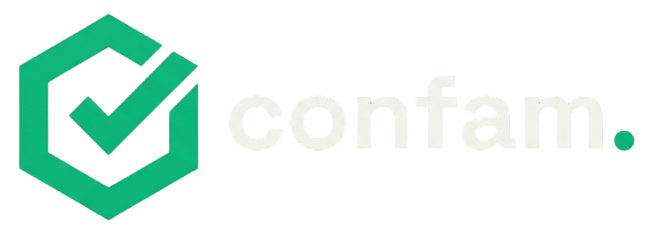

<p align="center">
  
</p>

<h1 align="center">Confam</h1>

<p align="center">Safer escrow and delivery tracking for social commerce.</p>

Confam helps buyers and vendors complete social-commerce deals with more confidence. Buyers fund escrow, vendors provide packing and dispatch evidence, and payout follows delivery confirmation. Disputes freeze escrow for admin review.

## What’s included

- **Escrow deal rooms** for sharing payment, item, and delivery status.
- **Vendor proof of packing** with video capture/upload, SHA-256 integrity checks, and optional Gemini review.
- **Waybill and delivery tracking** with receipt OCR and shareable driver location pings.
- **Buyer and vendor workspaces** with deal dashboards, analytics, profile and payout settings.
- **Authentication and account security** with email OTP verification, password recovery, remembered sessions, password re-entry, avatars, and session revocation.
- **Admin tools** for dispute resolution, revenue analytics, and safeguarded database resets.
- **Paystack integration** for checkout, account resolution, payout, and verified webhooks.

New deals charge buyers the item and delivery amounts. Confam deducts the platform fee from vendor proceeds at settlement. Existing deals keep their saved fee terms. Pending disputes do not trigger automatic payout.

## Technology

| App | Stack |
| --- | --- |
| `confam-api/` | PHP 8.3+, Laravel 13, Sanctum, SQLite by default |
| `confam-web/` | React 19, TypeScript, Vite |

You’ll also need Composer, Node.js, and npm.

## Run locally

### 1. Start the API

In PowerShell, from the repository root:

```powershell
Set-Location confam-api
composer install
if (-not (Test-Path .env)) {
    Copy-Item .env.example .env
}
php artisan key:generate

if (-not (Test-Path database\database.sqlite)) {
    New-Item -ItemType File database\database.sqlite | Out-Null
}
php artisan migrate
php artisan storage:link
php artisan serve
```

The API is available at `http://127.0.0.1:8000`; versioned endpoints use the `/api/v1` prefix.

### 2. Start the web app

In a second PowerShell terminal:

```powershell
Set-Location confam-web
npm install
```

Create `confam-web\.env.local`:

```dotenv
VITE_API_BASE_URL=http://127.0.0.1:8000/api/v1
```

Then start Vite:

```powershell
npm run dev
```

Open the local URL printed by Vite (normally `http://localhost:5173`). Set `FRONTEND_URL` in the API’s `.env` to the same origin.

## Integrations

Configure these values in `confam-api/.env` as needed:

| Variable | Used for |
| --- | --- |
| `PAYSTACK_SECRET_KEY` | Server-side checkout, account resolution, payouts, and webhook validation |
| `GEMINI_API_KEY`, `GEMINI_MODEL` | Waybill OCR and optional proof review |
| `MAIL_MAILER`, `MAIL_HOST`, `MAIL_PORT`, `MAIL_USERNAME`, `MAIL_PASSWORD` | SMTP delivery for email-verification and password-reset OTPs |
| `SANCTUM_EXPIRATION` | API token lifetime in minutes; the example is 30 days |
| `ADMIN_DATABASE_RESET_ENABLED` | Explicitly enable database reset in production; defaults to `false` |

Set `VITE_PAYSTACK_PUBLIC_KEY` in `confam-web/.env.local` for the browser checkout. Never put secret credentials in `VITE_` variables or commit `.env` files.

### Mailtrap OTP testing

The example API environment is set up for Mailtrap Email Testing. To receive OTP messages:

1. Open a Mailtrap Email Testing inbox and select its SMTP integration.
2. Put that inbox’s SMTP username and password in `confam-api/.env`.
3. Confirm the SMTP settings:

   ```dotenv
   MAIL_MAILER=smtp
   MAIL_SCHEME=null
   MAIL_HOST=sandbox.smtp.mailtrap.io
   MAIL_PORT=2525
   MAIL_USERNAME=your-mailtrap-inbox-username
   MAIL_PASSWORD=your-mailtrap-inbox-password
   MAIL_FROM_ADDRESS="hello@example.com"
   MAIL_FROM_NAME="${APP_NAME}"
   ```

4. Run `php artisan config:clear` and request a new verification or reset code. Check the Mailtrap inbox.

Mailtrap Email Testing captures messages for development; it does not deliver them to real users. Set up an approved production mail sender before enabling live account verification.

### Demo behavior

Without Paystack credentials, the API can use mock checkout behavior. Without a Gemini API key, OCR and proof-review features may return demo results. These modes are for development and do not process real payments or verify real evidence.

## Admin access and database reset

Public admin registration is disabled. From `confam-api/`, run:

```powershell
php artisan confam:create-admin
```

The interactive command creates or promotes an administrator account. Admins sign in through `/login` and access `/dashboard/admin`.

The admin dashboard includes a destructive reset control. Before deleting data, it requires the current admin password, the exact phrase `RESET DATABASE`, and a successfully created private database backup. It preserves the schema and all administrator accounts, removes deals and non-admin accounts, and revokes other sessions. **Proof videos, receipt images, and avatars in file storage are not deleted.** Reset is disabled in production unless `ADMIN_DATABASE_RESET_ENABLED=true` is explicitly set. MySQL and PostgreSQL backups require `mysqldump` or `pg_dump` to be available on the API host.

## API overview

All endpoints are prefixed with `/api/v1`.

| Area | Routes |
| --- | --- |
| Health | `GET /health` |
| Registration and sign-in | `POST /auth/register`, `POST /auth/login` |
| Email verification | `POST /auth/verification/verify`, `POST /auth/verification/resend` |
| Password recovery | `POST /auth/password/forgot`, `POST /auth/password/reset` |
| Session security | `POST /auth/unlock`, `GET /auth/sessions`, `DELETE /auth/sessions/{tokenId}`, `POST /auth/logout` |
| Vendor and buyer | `GET /vendor/deals`, `GET /buyer/deals`, `PATCH /vendor/profile` |
| Deals and payments | `POST /deals`, `GET /deals/{short_code}`, `POST /deals/{short_code}/pay`, `POST /deals/{short_code}/verify-payment` |
| Proof and dispatch | `POST /deals/{short_code}/proof`, `POST /deals/{short_code}/parse-waybill`, `POST /deals/{short_code}/dispatch` |
| Delivery and disputes | `POST /deals/{short_code}/confirm-delivery`, `POST /deals/{short_code}/dispute`, `POST /deals/{short_code}/release` |
| Admin | `GET /admin/disputes`, `GET /admin/revenue`, `POST /admin/deals/{short_code}/resolve` |
| Admin database tools | `GET /admin/database/reset-status`, `POST /admin/database/reset`, `GET /admin/database/backups/{fileName}` |

The email-verification endpoint is registered at `POST /api/v1/auth/verification/verify`. If the app reports that it cannot find the route, check `VITE_API_BASE_URL`, clear Laravel’s route/config cache with `php artisan optimize:clear`, and restart the API process.

## Production notes

- Use HTTPS for the API and frontend. Set the API’s `APP_URL` to its public origin and `FRONTEND_URL` to the deployed web-app origin.
- Set the frontend’s `VITE_API_BASE_URL` to the public API URL ending in `/api/v1`.
- Configure production Paystack, Gemini, and email credentials in the API environment, never in the frontend.
- Review the Terms, Privacy, and Cookies pages with the appropriate legal and jurisdictional details before launch.

## Development checks

From `confam-web/`:

```powershell
npm run build
npm run lint
```

From `confam-api/`:

```powershell
php artisan test
```

## Repository layout

```text
confam-api/
  app/                  Controllers, models, notifications, and services
  database/migrations/  Database schema
  routes/api.php        Versioned API routes
  tests/                Laravel/Pest tests
confam-web/
  public/               Logo and static assets
  src/api/              API client
  src/components/       Shared UI and dashboard components
  src/pages/            Marketing, auth, and dashboard pages
```
